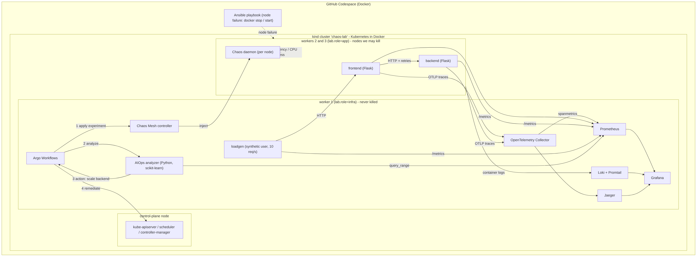

# Chaos Engineering Framework for Resilient Distributed Systems with AIOps Feedback Loops

EduQual Level 6 - Diploma in AI Operations. Author: Kabeer Afzaal.

A two-tier microservice (frontend -> backend) runs on a 4-node Kubernetes cluster (kind, Docker). Faults are injected
with **Chaos Mesh** (pod kill, network latency, CPU exhaustion) and **Ansible** (node failure), orchestrated by **Argo Workflows**.
**Prometheus + Grafana + OpenTelemetry + Jaeger + Loki** collect metrics, traces and logs. A **Python/scikit-learn (Isolation Forest)**
analyzer detects the anomaly, computes resilience KPIs and triggers an automatic remediation (the feedback loop).
The same experiments are run on a weak design (v1) and a hardened design (v2) to prove the improvement.


Diagrams: `docs/diagrams/` (system architecture, network flow with failure injection points, data flow normal and failure).

## Reproduce (GitHub Codespaces, 4-core / 16 GB)
```bash
make tools      # python deps + ansible (docker, kubectl, helm, kind come from .devcontainer)
make up         # ~15 min: cluster, monitoring, chaos engine, Argo, app v1
make forward    # Grafana :3000 (admin/admin), Prometheus :9090, Jaeger :16686, Argo :2746
make experiment EXP=pod-kill      # also network-delay, cpu-stress
make node-failure
make version V=v2                 # hardened design, repeat the experiments
make suite && make compare        # full before/after study -> results/summary.md + summary.png
make down                         # delete the cluster
```
Stop the Codespace when idle (free quota is limited).

## Layout
`app/` services + load generator | `k8s/` manifests (app v1/v2, chaos, observability, Argo) | `aiops/` analyzer + comparison |
`ansible/` node-failure playbook | `scripts/` automation | `results/` real measured reports | `docs/` experiments, standards, diagrams | `tests/` unit tests.

See `docs/experiments.md` (hypotheses, measurement) and `docs/standards.md` (NIST / ISO 27001 / HA mapping).

## Results
Generated by `make compare` into `results/summary.md`. Numbers in this repo come only from real runs.
